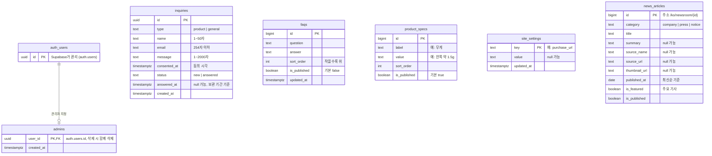

# 테이블 설계

> 원본: [노션 설계 문서](https://app.notion.com/p/e1289238025e82eba21901dc55b67002) · 마지막 반영일: 2026-10-31 (v1)
> 바뀌면 노션을 먼저 고치고 이 파일에 옮긴다(D-31).

## 1. 핵심 엔티티 도출

기능 명세(`docs/features.md`)에서 "저장되거나 바뀌는 것"만 골랐다. 긴 화면 문구(메인·회사·기술 소개 글)는 코드 안 파일에 두기로 해서(D-30) 테이블에서 뺐다.

| 엔티티      | 테이블          | 나온 곳               | 구분 | v1 마이그레이션                |
| ----------- | --------------- | --------------------- | ---- | ------------------------------ |
| 문의        | `inquiries`     | F-05, UC-05           | 필수 | ✅                             |
| FAQ         | `faqs`          | F-04, F-08, UC-09     | 필수 | ✅                             |
| 제품 사양   | `product_specs` | F-03, F-08, UC-10     | 필수 | ✅                             |
| 사이트 설정 | `site_settings` | F-06(구매 주소), F-13 | 필수 | ✅                             |
| 뉴스 기사   | `news_articles` | F-11, F-12            | 필수 | ✅                             |
| 관리자      | `admins`        | C-01, UC-08           | 도전 | ✅ (D-39. 관리 화면은 C-01 때) |

방문·클릭 지표(C-04·C-05)는 테이블 없이 PostHog로 확인한다(D-36).

## 2. ERD

- `||--o|`는 "로그인 사용자 1명 ↔ 관리자 0명 또는 1명"이다. **외래 키는 이것 하나뿐**이고, 나머지 테이블은 서로 참조하지 않는다.
- 허용 값(`type`, `status`, `category`)은 Postgres `enum` 대신 `text` + `check` 제약으로 둔다. 값을 추가할 때 제약만 바꾸면 된다.

## 3. 테이블 상세

### inquiries (문의)

| 컬럼         | 타입        | 제약                                   | 설명                                             |
| ------------ | ----------- | -------------------------------------- | ------------------------------------------------ |
| id           | uuid        | PK, 기본값 `gen_random_uuid()`         | 추측하기 어려운 번호                             |
| type         | text        | not null, `product`·`general` 중 하나  | 문의 유형: 제품·일반 (D-29)                      |
| name         | text        | not null, 1~50자                       |                                                  |
| email        | text        | not null, 254자 이하                   | 답변 받을 주소. 연락처는 받지 않음(팀 시트 제안) |
| message      | text        | not null, 1~2,000자                    | 길이 제한은 스팸 방어(D-08)                      |
| consented_at | timestamptz | not null                               | 개인정보 수집 동의 시각                          |
| status       | text        | not null, 기본 `new`, `new`·`answered` | 답변 여부. 답변 완료 알림 메일은 보류            |
| answered_at  | timestamptz | null 가능                              | 답변한 시각. 보관 기간(답변 후 1년) 계산 기준    |
| created_at   | timestamptz | not null, 기본 `now()`                 |                                                  |

- 보관: 동의 문구에는 "답변 후 1년"으로 안내한다. 기간이 지난 문의를 지우는 기능은 추후 결정하고, 지금은 지우지 않는다.

### faqs (FAQ)

| 컬럼         | 타입        | 제약                   | 설명           |
| ------------ | ----------- | ---------------------- | -------------- |
| id           | bigint      | PK, 자동 증가          |                |
| question     | text        | not null               |                |
| answer       | text        | not null               |                |
| sort_order   | int         | not null, 기본 0       | 작은 번호가 위 |
| is_published | boolean     | not null, 기본 false   | 공개 여부      |
| updated_at   | timestamptz | not null, 기본 `now()` |                |

- 처음 내용은 대표님 FAQ 자료(docx)에서 옮긴다.

### product_specs (제품 사양)

| 컬럼         | 타입    | 제약                | 설명                              |
| ------------ | ------- | ------------------- | --------------------------------- |
| id           | bigint  | PK, 자동 증가       |                                   |
| label        | text    | not null            | 예: 무게                          |
| value        | text    | not null            | 예: 한쪽 약 1.5g (대표님 확인 전) |
| sort_order   | int     | not null, 기본 0    |                                   |
| is_published | boolean | not null, 기본 true |                                   |

- 제품이 슬리비 하나뿐이라 제품 표를 따로 두지 않았다. 제품이 늘어나면 `products`를 만들고 `product_id`를 추가한다.

### site_settings (사이트 설정)

| 컬럼       | 타입        | 제약                   | 설명      |
| ---------- | ----------- | ---------------------- | --------- |
| key        | text        | PK                     | 설정 이름 |
| value      | text        | null 가능              |           |
| updated_at | timestamptz | not null, 기본 `now()` |           |

| key            | 값 예시     | 쓰는 곳                                                    |
| -------------- | ----------- | ---------------------------------------------------------- |
| `purchase_url` | (비어 있음) | F-06. 비어 있거나 `https://`로 시작하지 않으면 "출시 예정" |

- 회사 정보(상호, 주소, 사업자 등록 번호, 문의 이메일)는 자주 바뀌지 않아 처음엔 코드 상수로 둔다. 관리 화면에서 고쳐야 하면 여기로 옮긴다.

### news_articles (뉴스 기사)

| 컬럼          | 타입    | 제약                                 | 설명                               |
| ------------- | ------- | ------------------------------------ | ---------------------------------- |
| id            | bigint  | PK, 자동 증가                        | 주소 `/ko/newsroom/{id}`에 쓰임    |
| category      | text    | not null, `company`·`press`·`notice` | 기업 소식·보도자료·공지사항        |
| title         | text    | not null                             |                                    |
| summary       | text    | null 가능                            | 상세 화면 본문                     |
| source_name   | text    | null 가능                            | 언론사 이름                        |
| source_url    | text    | null 가능                            | 원문 주소. 공지사항은 없을 수 있음 |
| thumbnail_url | text    | null 가능                            |                                    |
| published_at  | date    | not null                             | 최신순 정렬 기준                   |
| is_featured   | boolean | not null, 기본 false                 | 주요 기사                          |
| is_published  | boolean | not null, 기본 false                 |                                    |

- 한국어만 저장한다(D-06). 다국어로 바뀌면 언어 컬럼이나 번역 표를 추가한다.
- 기사는 관리 화면이 생기기 전까지 Supabase 대시보드나 SQL로 넣는다(D-32).

### admins (관리자, v1부터. 관리 화면은 C-01)

| 컬럼       | 타입        | 제약                                         | 설명 |
| ---------- | ----------- | -------------------------------------------- | ---- |
| user_id    | uuid        | PK, `auth.users(id)` 참조, 삭제 시 함께 삭제 |      |
| created_at | timestamptz | not null, 기본 `now()`                       |      |

- 로그인 계정이 있어도 이 표에 있어야 관리자다. 회원가입 화면은 만들지 않고, 계정은 Supabase 대시보드에서 만든다.

### 방문·클릭 지표 (도전 C-04·C-05)

테이블을 두지 않는다. PostHog로 기록하고 PostHog 대시보드에서 확인한다(D-36).

## 4. 접근 권한 (RLS)

모든 테이블은 RLS를 켠다(D-13). "관리자"는 로그인했고 `admins`에 있는 사용자다.

| 테이블        | 방문자 (anon)    | 관리자          | 서버 전용 키 (service_role) |
| ------------- | ---------------- | --------------- | --------------------------- |
| inquiries     | 아무것도 못 함   | 읽기, 상태 변경 | 저장 (문의 Server Action)   |
| faqs          | 공개된 것만 읽기 | 전부            | -                           |
| product_specs | 공개된 것만 읽기 | 전부            | -                           |
| site_settings | 읽기             | 전부            | -                           |
| news_articles | 공개된 것만 읽기 | 전부            | -                           |
| admins        | 아무것도 못 함   | 자기 행만 읽기  | 관리자 추가                 |

## 5. 이미지

제품·뉴스 이미지는 처음엔 저장소 `public/`에 둔다. 관리 화면에서 올리게 되면 Supabase Storage 공개 버킷을 쓴다(C-01).

## 6. 확인이 필요한 것

- FAQ 카테고리는 지금 두지 않는다. 질문이 늘면 마이그레이션으로 `category` 칸을 추가하고 값을 채운다(D-34). 그때까지는 `sort_order`로 비슷한 질문끼리 묶는다: 사용 방법 → 착용·이어팁 → 사용 환경 → 충전 → 관리·보관 → 기타
- 초기 데이터(FAQ, 제품 사양, 뉴스 기사)는 마이그레이션 SQL로 넣는다. 관리 화면(C-01) 전까지는 Supabase 대시보드에서 고친다 (D-32)
- 구조가 바뀔 수 있는 곳 (둘 다 칸 추가라 마이그레이션으로 처리): 문의 폼 디자인에 칸이 늘면 `inquiries`에 추가, 본문을 직접 쓰는 기사가 생기면 `news_articles`에 본문 칸 추가
